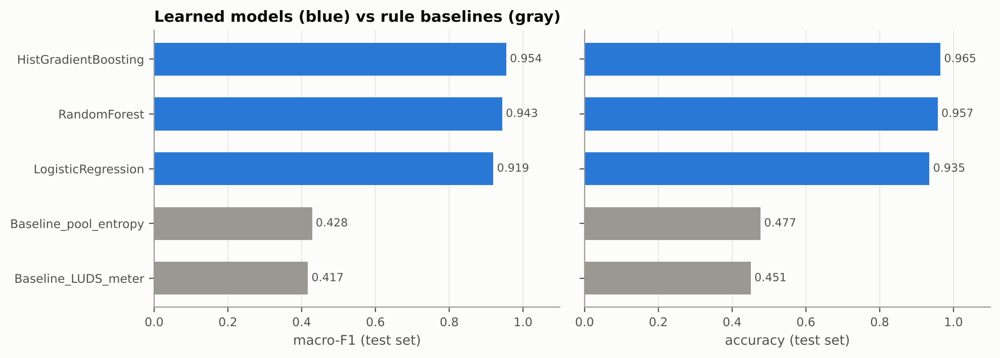
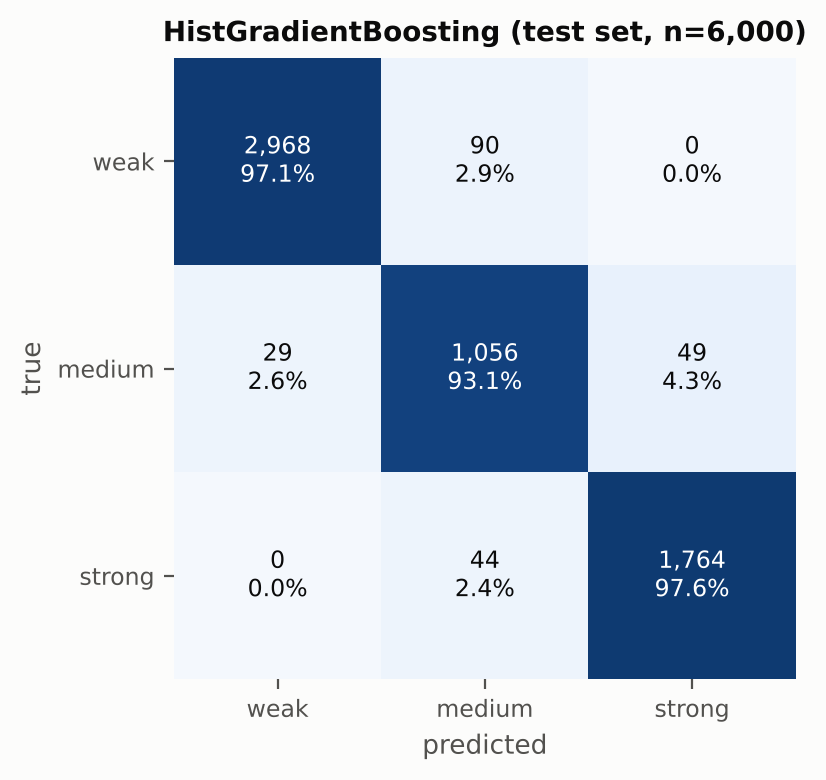
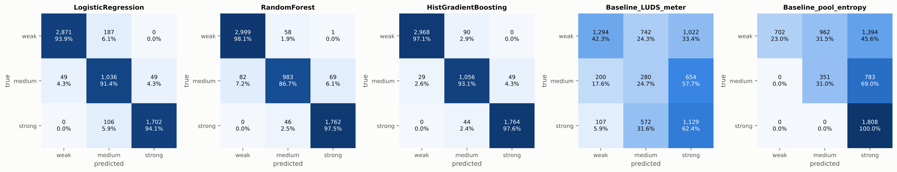
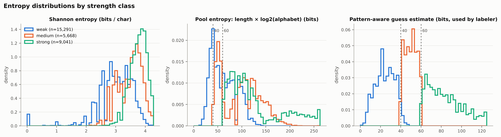
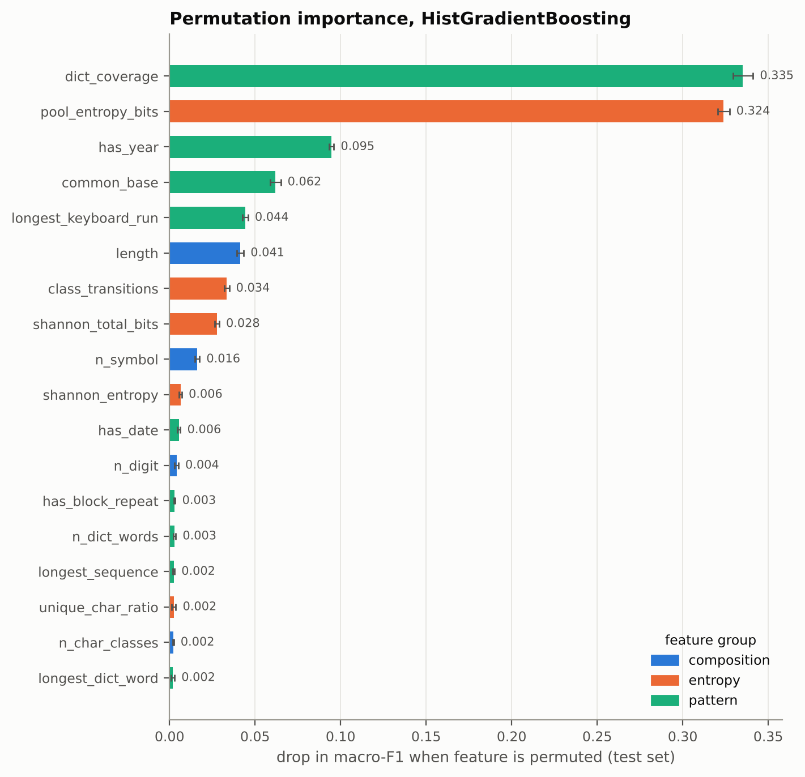
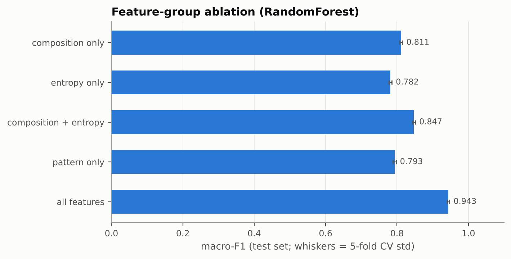
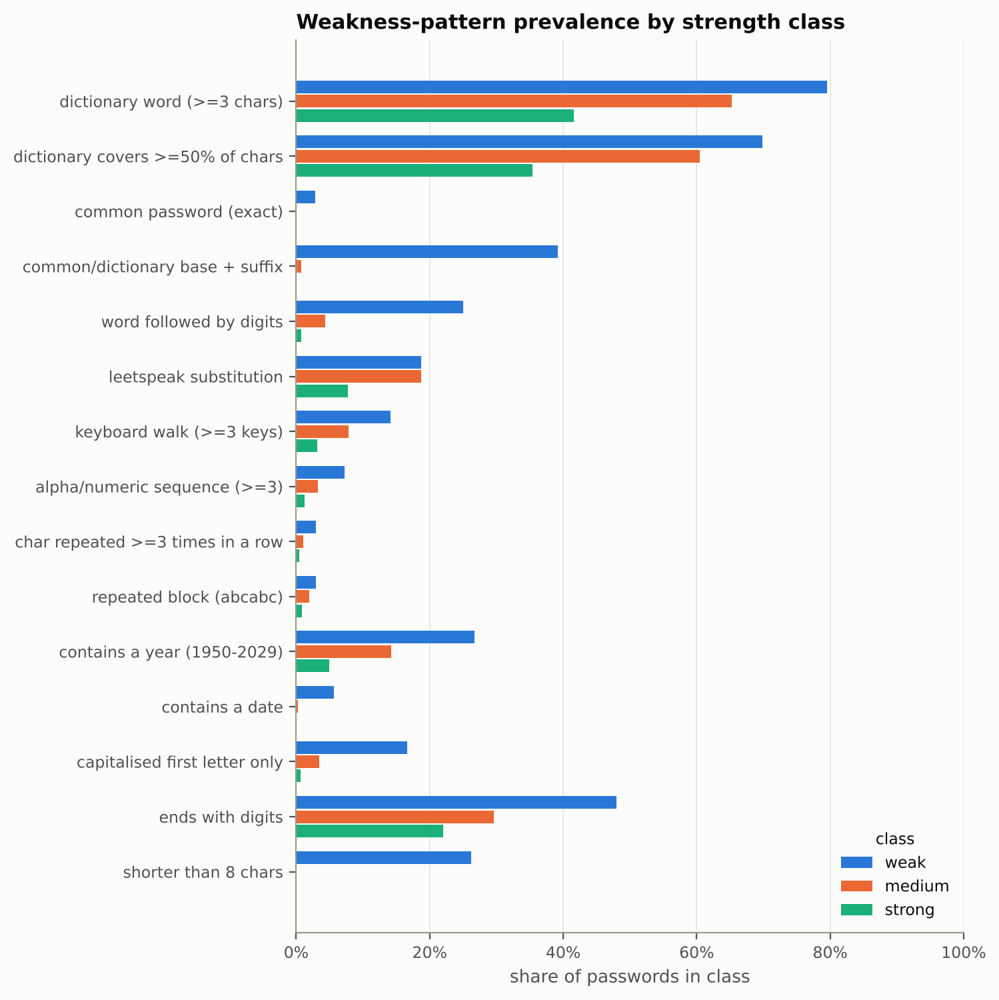
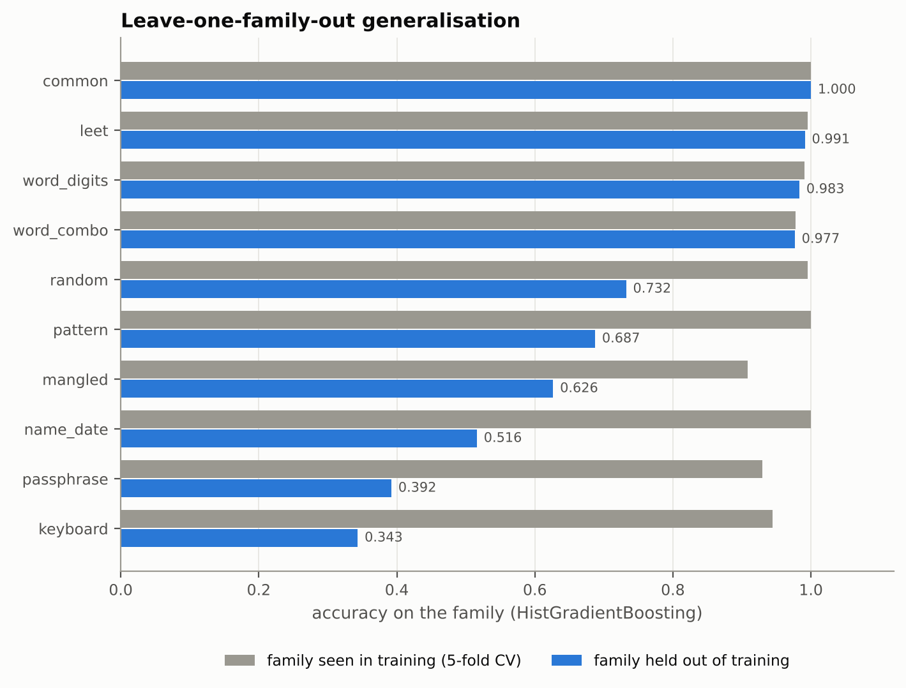

# Learning What Makes a Password Weak: Machine-Learning Strength Classification on a Synthetic, Pattern-Labelled Corpus

*Research mini-project. All code, data and figures are in this repository and are produced by `run_pipeline.py` (seed 42).*

---

## Abstract

Password-strength meters still often score passwords by length and character
composition. Practical guessing attacks, by contrast, exploit dictionary
words, keyboard walks, dates and predictable mangling. We study whether
lightweight machine-learning classifiers can recover a pattern-aware notion
of strength from cheap, interpretable features, and which features carry the
signal. Because real breached-password data is ethically problematic, we
build a fully synthetic corpus of **30,000 unique passwords** from ten
hand-designed generation families. Each password is labelled *weak*,
*medium* or *strong* by a transparent oracle: a simplified zxcvbn-style
minimum-guess estimator combined with explicit policy rules. We extract 31
features in three groups (composition, entropy, pattern) and compare
logistic regression, random forest and histogram gradient boosting against
two deployed-style baselines: a LUDS composition meter and a pool-entropy
meter. On a held-out test set of 6,000 passwords, gradient boosting reaches
**0.9647 accuracy and 0.9545 macro-F1**, against **0.4167** (LUDS) and
**0.4282** (pool entropy) for the baselines. The LUDS meter rates **34.2%** of
all weak passwords as *strong*. Permutation importance shows that weakness is
predicted mainly by **dictionary coverage** (Δ macro-F1 = 0.335 when
permuted), **pool entropy** (0.324), **presence of a year** (0.095),
**dictionary-base-plus-suffix structure** (0.062) and **keyboard-walk length**
(0.044). An ablation shows that pattern features raise macro-F1 from 0.847
(composition + entropy) to 0.944. A leave-one-family-out experiment shows the
main limitation of learned meters: accuracy falls to 0.34–0.52 on password
habits absent from training, such as keyboard walks, passphrases and
name+date.

---

## 1. Introduction

Text passwords remain the dominant authentication mechanism on the web,
despite decades of documented weaknesses [Florêncio & Herley 2007; Bonneau
2012]. Users choose memorable strings, and memorability correlates with
predictability: words, names, birth years, keyboard rows, and a capital
letter or "!" added to satisfy a policy [Komanduri et al. 2011; Weir et al.
2010]. A *password-strength meter* is meant to steer users away from such
choices. Its usefulness depends on whether its score tracks how many guesses
an attacker actually needs [Ur et al. 2012; de Carnavalet & Mannan 2014].

Many meters still estimate strength from **composition**: length plus the
presence of lowercase, uppercase, digits and symbols (LUDS). Others use
**brute-force entropy**, `L · log2 N` for a length-`L` string over an
alphabet of size `N`. Both reward `Password2023!` as highly as a random
13-character string, although the former falls to a small dictionary attack
with simple mangling rules. Pattern-aware estimators such as zxcvbn
[Wheeler 2016] address this by searching for the cheapest decomposition of
the password into guessable patterns.

This project asks three questions:

* **RQ1.** How well do standard ML classifiers, trained on cheap per-password
  features, reproduce a pattern-aware three-class strength label, compared
  with composition and entropy meters?
* **RQ2.** Which features are most predictive of weakness, and what do the
  weak passwords have in common?
* **RQ3.** How well does a learned meter generalise to password-creation
  habits it was not trained on?

**Contributions.** (i) A reproducible, ethically clean, synthetic labelled
corpus whose labels are fully auditable: each label records the rule that
fired and the pattern decomposition. (ii) A comparison of three classifiers
against two deployed-style baselines. (iii) A feature-importance, ablation
and prevalence analysis of weak-password patterns. (iv) A
leave-one-family-out evaluation that measures the external-validity risk of
learned meters.

---

## 2. Background & Related Work

**Entropy and its misuse.** Shannon entropy [Shannon 1948] measures the
average information of a random source. Applied to a single password, it
appears in two forms. The *empirical character entropy*
`H = −Σ p_i log2 p_i` over the characters of the string measures character
diversity, not unpredictability. The *brute-force* or *pool* entropy
`L · log2 N` is an upper bound that holds only if every character is chosen
uniformly at random. The NIST SP 800-63 guideline of 2004/2006 [Burr et al.
2006] proposed a heuristic entropy estimate for user-chosen passwords. Weir
et al. [2010] showed empirically that such entropy scores correlate poorly
with resistance to real cracking attacks. The 2017 revision, SP 800-63B
[Grassi et al. 2017], dropped composition rules in favour of minimum length
and blocklists of known-compromised and dictionary passwords.

**Guessability as the ground truth.** Bonneau [2012] argued for
guessing-based metrics computed over password distributions. Kelley et al.
[2012] and Ur et al. [2015] measured strength as the number of guesses that
a concrete cracking algorithm needs: PCFG-based [Weir et al. 2009], Markov
[Castelluccia et al. 2012], or rule-based (John the Ripper, Hashcat). They
found that a single algorithm can be biased and that min-of-several-attackers
is more robust.

**Strength estimation.** zxcvbn [Wheeler 2016] matches dictionary words
(ranked by frequency, with l33t, capitalisation and reversal variants),
spatial keyboard patterns, repeats, sequences and dates. It then finds the
minimum-guess decomposition with dynamic programming and maps
`log10(guesses)` to a 0–4 score. Castelluccia et al. [2012] built adaptive
Markov-model meters. Melicher et al. [2016] trained a compact neural network
on leaked passwords to estimate guessability client-side. Generative models
such as PassGAN [Hitaj et al. 2019] learn the password distribution
directly. Ur et al. [2012] showed that meter feedback changes user
behaviour, and de Carnavalet & Mannan [2014] found that deployed meters
disagree widely and often reward trivial mangling.

**Our position.** Most learned meters are trained on leaked corpora. We use
no real credentials. Instead we generate passwords from documented human
habits and label them with an explicit, zxcvbn-inspired oracle. This makes
the ML question narrower but fully transparent: *can cheap features
approximate an expensive pattern-aware estimator, and which features matter?*
Our tree ensembles follow Breiman [2001], Friedman [2001] and Ke et al.
[2017], as implemented in scikit-learn [Pedregosa et al. 2011].

---

## 3. Methodology

### 3.1 Synthetic password generation

`src/pwstrength/generator.py` draws passwords from ten families. Their
sampling weights are given in parentheses:

* *common* (0.05): a hand-listed weak password, sometimes capitalised or
  suffixed.
* *word_digits* (0.08): word or name + digits or year.
* *leet* (0.07): leetspeak word + optional suffix.
* *keyboard* (0.05): concatenated keyboard-row and keyboard-column walks.
* *name_date* (0.05): name + date or year.
* *word_combo* (0.08): two words with a separator.
* *passphrase* (0.15): 3–6 uniformly drawn words.
* *mangled* (0.17): policy-compliant human passwords such as
  `l4dder!BUTTER9`, sometimes with a short random chunk.
* *pattern* (0.03): repeats and sequences.
* *random* (0.27): uniform strings of length 6–20 over a random subset of
  character classes.

All vocabulary comes from hand-written lists in
`src/pwstrength/wordlists.py`: 232 generic weak passwords, 418 English words
and 90 first names. **No leaked-credential data is used.** We drew 30,000
unique passwords. De-duplication guarantees that no string appears in both
train and test.

### 3.2 Labelling oracle

**Guess estimator.** `src/pwstrength/patterns.py` enumerates the following
candidate matches, each with a cost in bits (log2 guesses):

* Dictionary substrings of length ≥ 3, found plain, de-leeted or reversed.
  Cost is `log2(rank)`, plus zxcvbn's capitalisation-variation bits, 1 bit
  per leet substitution and 1 bit for reversal.
* Keyboard walks of ≥ 3 adjacent keys along a QWERTY row or column. Cost is
  `log2(#keys) + 1 + log2(L)`.
* ±1 sequences. Cost is `log2(26 or 10) + 1 + log2(L)`.
* Character repeats. Cost is `log2(class pool) + log2(L)`.
* Repeated blocks. Cost is the block's own estimate + `log2(count)`.
* Years (1950–2029, `log2 80`) and calendar dates (`log2(31·12·80)`).

`labeler.py` then uses dynamic programming to cover the string with the
cheapest mix of matches. Each match adds a 1-bit segment penalty, and each
uncovered character costs `log2(pool)`, where *pool* is the alphabet size
implied by the classes present (26/26/10/33).

**Rules.** Rules are applied in order, and the first match decides the label:

| Rule | Condition | Label |
|---|---|---|
| R1 | the password, lower-cased or de-leeted, is in the common list | weak |
| R2 | length < 8 | weak |
| R3 | estimate < 40 bits | weak |
| R4 | estimate ≥ 60 bits and length ≥ 10 | strong |
| R5 | otherwise | medium |

40 bits ≈ 1.1 × 10¹² guesses and 60 bits ≈ 1.2 × 10¹⁸ guesses. These values
bracket the ~10¹⁴-guess offline-attack threshold discussed by Florêncio et
al. [2014]. A *weak* password is therefore well within reach of an offline
attack on a fast hash, and a *strong* one is far beyond it. The thresholds
are design parameters, not empirical constants.

**Resulting corpus.** The 30,000 passwords split into 15,291 weak (51.0%),
5,668 medium (18.9%) and 9,041 strong (30.1%). The rules fired as follows:
R3 11,207; R4 9,041; R5 5,668; R2 3,645; R1 439. Table 1 shows how the
families map onto classes (`results/family_by_class.csv`).

*Table 1. Class composition of each generation family.*

| family | weak | medium | strong |
|---|---|---|---|
| common | 786 | 0 | 0 |
| keyboard | 1,296 | 217 | 16 |
| leet | 1,962 | 96 | 5 |
| mangled | 2,200 | 1,870 | 1,292 |
| name_date | 1,562 | 0 | 0 |
| passphrase | 788 | 1,571 | 2,359 |
| pattern | 550 | 0 | 0 |
| random | 1,317 | 1,744 | 5,369 |
| word_combo | 2,353 | 128 | 0 |
| word_digits | 2,477 | 42 | 0 |

### 3.3 Features

`src/pwstrength/features.py` computes 31 features. The oracle's bit
estimate is deliberately *excluded*, so the label cannot leak into the
inputs.

* **Composition (9):** length; counts of lowercase, uppercase, digits and
  symbols; number of classes; fractions of uppercase, digits and symbols.
* **Entropy (5):** empirical Shannon entropy (bits/char); Shannon × length;
  pool entropy `L·log2 N`; unique-character ratio; number of
  character-class transitions.
* **Pattern (17):** has/longest/number of dictionary words; dictionary
  coverage (the fraction of characters inside any dictionary match); leet
  flag; longest keyboard run; longest sequence; longest single-character
  repeat; repeated-block flag; year flag; date flag; exact common-password
  flag; *common base* (the string minus trailing digits and symbols is a
  dictionary or common word); *word-then-digits* shape; capitalised-first-
  letter-only; digits at end; symbol at end.

The pattern features reuse the oracle's matchers. They are cheap
*indicators* of each match type, however, not its cost, and they are never
combined into a decomposition.

### 3.4 Models, baselines and protocol

* **Logistic regression:** standardised inputs, multinomial, L2 penalty with
  C = 1.
* **Random forest:** 200 trees, `balanced_subsample` class weights.
* **Histogram gradient boosting:** 300 iterations, learning rate 0.1,
  balanced class weights.
* **LUDS baseline:** one point each for length ≥ 8, length ≥ 12, both cases
  present, a digit and a symbol. 0–2 points = weak, 3 = medium,
  4–5 = strong.
* **Pool-entropy baseline:** `L·log2 N` with the same 40/60-bit thresholds
  as the oracle.

We use a stratified 80/20 split (24,000 train / 6,000 test). Each learned
model is also scored with 5-fold stratified CV on the training split. The
primary metric is **macro-F1**, because classes are imbalanced. Feature
importance is measured as test-set permutation importance on macro-F1 (10
repeats). Impurity importances are biased towards continuous features
[Strobl et al. 2007], so they are reported only for comparison. Two further
experiments probe RQ2 and RQ3: (i) a feature-group ablation with the random
forest, and (ii) **leave-one-family-out (LOFO)**, in which gradient boosting
is trained on nine families and tested on the tenth. LOFO accuracy is
compared with 5-fold out-of-fold accuracy on the same family. A single seed
(42) controls everything. Two consecutive full runs produced byte-identical
data and metrics, apart from wall-clock fit times.

---

## 4. Experiments & Results

### 4.1 Classification performance (RQ1)

*Table 2. Test-set performance (n = 6,000). Source: `results/metrics.csv`.*

| model | accuracy | macro-P | macro-R | macro-F1 | 5-fold CV macro-F1 |
|---|---|---|---|---|---|
| **HistGradientBoosting** | **0.9647** | **0.9502** | **0.9591** | **0.9545** | 0.9533 ± 0.0023 |
| RandomForest | 0.9573 | 0.9465 | 0.9407 | 0.9435 | 0.9461 ± 0.0028 |
| LogisticRegression | 0.9348 | 0.9116 | 0.9313 | 0.9194 | 0.9209 ± 0.0021 |
| Baseline: pool entropy | 0.4768 | 0.5737 | 0.5130 | 0.4282 | — |
| Baseline: LUDS meter | 0.4505 | 0.4621 | 0.4315 | 0.4167 | — |

*Figure 1. Macro-F1 and accuracy of learned models (blue) and rule baselines
(gray) on the test set.*

All three learned models exceed 0.91 macro-F1, and their CV estimates agree
with the test scores to within 0.003. Gradient boosting is best, with
per-class F1 of 0.980 (weak), 0.909 (medium) and 0.974 (strong). *Medium* is
the hardest class for every model. Logistic regression's medium-class
precision is only 0.780: a linear boundary cannot represent the narrow
40–60-bit band well.

*Figure 2. Confusion matrix of HistGradientBoosting on the test set (counts
and row percentages).*

*Figure 3. Confusion matrices of all models and baselines.*

Gradient boosting makes 212 errors out of 6,000 (Figure 2). **None are
weak↔strong confusions.** All errors are between adjacent classes: 90 weak→
medium, 29 medium→weak, 49 medium→strong and 44 strong→medium. 62.3% of the
misclassified passwords lie within 3 bits of a 40/60-bit threshold, and their
median oracle estimate is 42.6 bits. The *mangled* and *passphrase* families
account for 168 of the 212 errors (79.2%). Typical examples are
`I$l4nd#Pearl38` (weak, 38.9 bits, predicted medium) and
`Happy_Pepper_Black_Devil4` (medium, 56.1 bits, predicted strong)
(`results/errors_HistGradientBoosting.csv`).

The baselines fail in a characteristic way (Figure 3). The **pool-entropy
meter** labels every strong password correctly (recall 1.000) but rates
45.6% of weak test passwords strong and recovers only 23.0% of them as weak.
Its scale is right for random strings and blind to structure. The **LUDS
meter** rates 33.4% of weak test passwords strong. Across the whole corpus,
**5,230 passwords, 34.2% of all weak passwords**, are LUDS-strong but
oracle-weak. Examples include `TigerPeter1973` (22.2 bits),
`peach#Emily2019` (26.3 bits) and `n37w0rk&Queen1994` (32.7 bits)
(`results/luds_false_strong_examples.csv`).

### 4.2 Entropy distributions

*Figure 4. Per-class density of empirical Shannon entropy (left), pool
entropy (middle) and the oracle's pattern-aware estimate (right). Dashed
lines mark the 40/60-bit thresholds.*

Both naive entropy measures overlap heavily across classes (Figure 4). The
median Shannon entropy is 3.06 bits/char for weak passwords against 3.57
(medium) and 3.79 (strong). The weak distribution, however, extends over the
whole range of the strong one. Median pool entropy is 57.7 bits for weak
passwords, which would make the *typical* weak password "medium" under a
pool-entropy rule. The pattern-aware estimate separates the classes by
construction (medians 24.4 / 50.1 / 80.2 bits). Comparing the middle and
right panels makes the core issue visible: for a weak password, pool entropy
exceeds the pattern-aware estimate by a median of 36.3 bits. That is how much
credit brute-force entropy gives to structure an attacker can exploit.

### 4.3 Most predictive weakness features (RQ2)

*Figure 5. Test-set permutation importance (drop in macro-F1, mean ± std over
10 repeats) for HistGradientBoosting, coloured by feature group.*

*Table 3. Top features by permutation importance, HistGradientBoosting.
Source: `results/permutation_importance_HistGradientBoosting.csv`.*

| rank | feature | group | Δ macro-F1 |
|---|---|---|---|
| 1 | `dict_coverage` | pattern | 0.3352 ± 0.0059 |
| 2 | `pool_entropy_bits` | entropy | 0.3239 ± 0.0035 |
| 3 | `has_year` | pattern | 0.0947 ± 0.0014 |
| 4 | `common_base` | pattern | 0.0619 ± 0.0031 |
| 5 | `longest_keyboard_run` | pattern | 0.0442 ± 0.0017 |
| 6 | `length` | composition | 0.0413 ± 0.0020 |
| 7 | `class_transitions` | entropy | 0.0335 ± 0.0014 |
| 8 | `shannon_total_bits` | entropy | 0.0278 ± 0.0013 |

Two features dominate (Figure 5). **Dictionary coverage** measures how much
of the password a dictionary attack explains. **Pool entropy** is the
brute-force budget available for the rest. Together they form a cheap,
learned approximation of the oracle's "patterns + brute-force remainder"
decomposition. The random forest ranks the same three features first
(`pool_entropy_bits` 0.119, `dict_coverage` 0.099, `has_year` 0.076). Its
impurity importances instead favour continuous features such as
`class_transitions` (0.094) and `shannon_total_bits` (0.091), as expected
from impurity bias.

Some features have near-zero importance:

* `is_common_password` (0.000): common passwords are short and
  dictionary-covered, so other features already identify them.
* `has_leet` (0.002): de-leeted dictionary matching already folds leet into
  `dict_coverage`.
* `n_char_classes` (0.002): this is notable, because the class count is
  exactly what LUDS meters reward.

Logistic-regression coefficients point the same way: `dict_coverage` has
the largest weak-class coefficient (+12.59), followed by `has_year` (+2.79)
and `longest_keyboard_run` (+2.32). The negative sign on `has_dict_word`
(−4.31) is a collinearity artefact, since that flag is almost implied by
coverage. It should not be read as "dictionary words make a password
stronger".

**Ablation.** Table 4 and Figure 6 show that no single feature group
suffices. Composition plus entropy reaches 0.847 macro-F1, and pattern
features alone reach only 0.793. Combining all three raises macro-F1 to
0.944 and weak-class recall from 0.929 to 0.981. The groups are therefore
complementary: patterns say *what part* of a password is guessable, and
composition/entropy say *how much* randomness remains.

*Table 4. Feature-group ablation, RandomForest. Source: `results/ablation.csv`.*

| feature set | #features | test macro-F1 | CV macro-F1 | weak recall |
|---|---|---|---|---|
| composition only | 9 | 0.8113 | 0.8178 ± 0.0038 | 0.8538 |
| entropy only | 5 | 0.7816 | 0.7848 ± 0.0039 | 0.8378 |
| composition + entropy | 14 | 0.8473 | 0.8511 ± 0.0032 | 0.9290 |
| pattern only | 17 | 0.7933 | 0.7875 ± 0.0049 | 0.8640 |
| all features | 31 | 0.9435 | 0.9461 ± 0.0028 | 0.9807 |

*Figure 6. Macro-F1 of the random forest per feature set.*

**What weak passwords have in common.** Figure 7 and Table 5 report how
often each weakness pattern occurs per class, with "lift" defined as the
weak-class rate divided by the rate in the other two classes.

*Table 5. Pattern prevalence by class (selected rows). Source:
`results/pattern_prevalence_by_class.csv`.*

| pattern | weak | medium | strong | lift |
|---|---|---|---|---|
| contains dictionary word (≥ 3 chars) | 79.6% | 65.2% | 41.6% | 1.6× |
| common/dictionary base + suffix | 39.2% | 0.7% | 0.0% | 137× |
| contains a date | 5.7% | 0.3% | 0.0% | 49× |
| word followed by digits | 25.1% | 4.4% | 0.7% | 11.7× |
| capitalised first letter only | 16.6% | 3.5% | 0.6% | 9.7× |
| alpha/numeric sequence (≥ 3) | 7.2% | 3.3% | 1.2% | 3.6× |
| contains a year (1950–2029) | 26.8% | 14.2% | 5.0% | 3.1× |
| keyboard walk (≥ 3 keys) | 14.2% | 7.8% | 3.2% | 2.9× |
| ends with digits | 48.0% | 29.7% | 22.0% | 1.9× |
| leetspeak substitution | 18.7% | 18.8% | 7.7% | 1.6× |

*Figure 7. Share of passwords in each class that show each pattern.*

The most *discriminative* signature of a weak password is the shape
**"known word + predictable suffix"**: 39.2% of weak passwords versus 0.7%
of medium passwords. The second is **date or year material**. Containing a
dictionary word is common in every class. Short words even occur by chance
in 41.6% of strong, mostly random, strings. What matters is the *coverage*
(Table 3). Leetspeak hardly separates weak from medium (18.7% vs 18.8%),
which confirms that leet substitution adds little guessing resistance. The
oracle's cheapest decomposition of weak passwords uses a dictionary segment
in 78.5% of cases, a year in 24.3%, a keyboard walk in 8.3% and a date in
5.6% (`results/weak_decomposition_patterns.csv`).

### 4.4 Generalisation to unseen habits (RQ3)

*Figure 8. HistGradientBoosting accuracy on each family when the family is
seen in training (5-fold out-of-fold, gray) vs held out (blue).*

*Table 6. Leave-one-family-out accuracy. Source:
`results/leave_one_family_out.csv`.*

| held-out family | n | in-distribution | held out |
|---|---|---|---|
| keyboard | 1,529 | 0.944 | **0.343** |
| passphrase | 4,718 | 0.929 | **0.392** |
| name_date | 1,562 | 1.000 | **0.516** |
| mangled | 5,362 | 0.908 | 0.626 |
| pattern | 550 | 1.000 | 0.687 |
| random | 8,430 | 0.995 | 0.732 |
| word_combo | 2,481 | 0.977 | 0.977 |
| word_digits | 2,519 | 0.991 | 0.983 |
| leet | 2,063 | 0.995 | 0.991 |
| common | 786 | 1.000 | 1.000 |

The overall test scores in §4.1 hide a strong dependence on the training
distribution. Families whose *structure* is shared with other families
transfer almost perfectly when held out: word+digits, word combinations,
leet and common all stay ≥ 0.977. Families with a *distinct* signature
collapse:

* **Keyboard walks: 0.343.** No other family teaches the model that a long
  `longest_keyboard_run` means weakness. Strings like `)(*&^%$xsw254321` look
  high-entropy.
* **Passphrases: 0.392.** Long, multi-word strings occur nowhere else with
  medium or strong labels, so the model treats high dictionary coverage as
  weakness.
* **Name+date: 0.516.** The `has_date` flag is never informative in
  training without this family.

A learned meter is therefore only as good as the password habits
represented in its training data. An attacker, or a user, who adopts a
habit the meter has not seen can get systematically wrong scores.

---

## 5. Discussion & Limitations

**Interpretation.** Cheap features plus a tree ensemble reproduce a
dynamic-programming guess estimator with 96.5% accuracy and never confuse
weak with strong. The learned model mainly combines "how much of this is a
dictionary word" with "how big is the remaining brute-force space", which is
the decomposition zxcvbn computes explicitly. By contrast, the two rule
meters that are still widely deployed are near chance for this three-class
task (macro-F1 ≈ 0.42). The LUDS meter credits a third of weak passwords as
strong, which supports the move in NIST SP 800-63B away from composition
rules and towards blocklists [Grassi et al. 2017].

**Practical guidance from the analysis.** For users and policy designers,
the features with the highest lift give concrete advice. Avoid a known word
followed by digits or a symbol, avoid years and dates, and avoid keyboard
rows. Do not rely on leetspeak or a capitalised first letter, both of which
add very few bits.

**Limitations.**

1. **Circularity.** Labels come from our own oracle, and some features reuse
   its matchers. The models therefore learn to imitate *this* estimator, not
   real attacker success. The high test scores measure how compressible the
   oracle is into cheap features. They are not a validation against real
   cracking. External validity would require guess numbers from real
   cracking tools [Ur et al. 2015], which we deliberately avoid computing on
   real credentials.
2. **Synthetic distribution.** Family weights and templates are our own
   design. Real password distributions are Zipfian and far more diverse
   [Bonneau 2012]. The LOFO results show how sensitive learned meters are to
   this choice.
3. **Small dictionaries.** The attacker dictionaries hold 740 entries.
   This makes passphrases built from them look weaker than passphrases drawn
   from a 7,776-word Diceware list. Conversely, words outside the lists, such
   as `troubador`, are scored as random, which overstates strength.
4. **Simplified estimator.** We omit zxcvbn's l33t combinatorics,
   shifted-key turns, graph-distance spatial patterns and multi-dictionary
   frequency data. The 1-bit segment penalty and the 40/60-bit thresholds
   are design choices.
5. **Label granularity.** Three classes cut a continuous quantity. Most
   errors lie within 3 bits of a threshold, so some "errors" are boundary
   noise rather than real mistakes. Regression on the bit estimate, or
   ordinal methods, would be natural extensions.
6. **English and QWERTY bias.** Only English words, a few Thai and English
   names, and a US QWERTY layout are modelled.

**Threats to internal validity** are limited. Duplicates are removed before
splitting, the oracle score is excluded from the features, and CV and test
estimates agree to within 0.003 macro-F1.

---

## 6. Conclusion

We built a fully synthetic, auditable benchmark for password-strength
classification and showed four things:

1. Gradient boosting on 31 interpretable features reaches 0.9545 macro-F1
   against a pattern-aware oracle, while LUDS and pool-entropy meters reach
   only about 0.42.
2. Weakness is predicted mainly by dictionary coverage, the remaining
   brute-force space, years, word+suffix structure and keyboard walks.
   Character-class count is nearly irrelevant.
3. A third of weak passwords satisfy a typical composition policy.
4. Learned meters can fail badly on password habits missing from their
   training data.

In practice, pattern-aware estimation (explicit or learned) should replace
composition rules. Any learned meter should be stress-tested with
leave-one-habit-out evaluation before deployment. Future work could train
against a min-of-attackers guess number, add regression and ordinal models,
and extend the dictionaries and keyboard layouts to other languages.

---

## References

- Bonneau, J. (2012). The Science of Guessing: Analyzing an Anonymized Corpus of 70 Million Passwords. *IEEE Symposium on Security and Privacy*, 538–552.
- Breiman, L. (2001). Random Forests. *Machine Learning*, 45(1), 5–32.
- Burr, W. E., Dodson, D. F., & Polk, W. T. (2006). *Electronic Authentication Guideline* (NIST Special Publication 800-63, Version 1.0.2). National Institute of Standards and Technology.
- Castelluccia, C., Dürmuth, M., & Perito, D. (2012). Adaptive Password-Strength Meters from Markov Models. *Network and Distributed System Security Symposium (NDSS)*.
- de Carné de Carnavalet, X., & Mannan, M. (2014). From Very Weak to Very Strong: Analyzing Password-Strength Meters. *Network and Distributed System Security Symposium (NDSS)*.
- Florêncio, D., & Herley, C. (2007). A Large-Scale Study of Web Password Habits. *Proceedings of the 16th International World Wide Web Conference (WWW)*, 657–666.
- Florêncio, D., Herley, C., & van Oorschot, P. C. (2014). An Administrator's Guide to Internet Password Research. *USENIX Large Installation System Administration Conference (LISA)*.
- Friedman, J. H. (2001). Greedy Function Approximation: A Gradient Boosting Machine. *Annals of Statistics*, 29(5), 1189–1232.
- Grassi, P. A., Fenton, J. L., Newton, E. M., Perlner, R. A., Regenscheid, A. R., Burr, W. E., Richer, J. P., et al. (2017). *Digital Identity Guidelines: Authentication and Lifecycle Management* (NIST Special Publication 800-63B). National Institute of Standards and Technology.
- Hitaj, B., Gasti, P., Ateniese, G., & Perez-Cruz, F. (2019). PassGAN: A Deep Learning Approach for Password Guessing. *Applied Cryptography and Network Security (ACNS)*, 217–237.
- Ke, G., Meng, Q., Finley, T., Wang, T., Chen, W., Ma, W., Ye, Q., & Liu, T.-Y. (2017). LightGBM: A Highly Efficient Gradient Boosting Decision Tree. *Advances in Neural Information Processing Systems 30*.
- Kelley, P. G., Komanduri, S., Mazurek, M. L., Shay, R., Vidas, T., Bauer, L., Christin, N., Cranor, L. F., & Lopez, J. (2012). Guess Again (and Again and Again): Measuring Password Strength by Simulating Password-Cracking Algorithms. *IEEE Symposium on Security and Privacy*, 523–537.
- Komanduri, S., Shay, R., Kelley, P. G., Mazurek, M. L., Bauer, L., Christin, N., Cranor, L. F., & Egelman, S. (2011). Of Passwords and People: Measuring the Effect of Password-Composition Policies. *ACM CHI Conference on Human Factors in Computing Systems*, 2595–2604.
- Melicher, W., Ur, B., Segreti, S. M., Komanduri, S., Bauer, L., Christin, N., & Cranor, L. F. (2016). Fast, Lean, and Accurate: Modeling Password Guessability Using Neural Networks. *25th USENIX Security Symposium*, 175–191.
- Pedregosa, F., Varoquaux, G., Gramfort, A., Michel, V., Thirion, B., et al. (2011). Scikit-learn: Machine Learning in Python. *Journal of Machine Learning Research*, 12, 2825–2830.
- Shannon, C. E. (1948). A Mathematical Theory of Communication. *Bell System Technical Journal*, 27(3), 379–423.
- Strobl, C., Boulesteix, A.-L., Zeileis, A., & Hothorn, T. (2007). Bias in Random Forest Variable Importance Measures: Illustrations, Sources and a Solution. *BMC Bioinformatics*, 8, 25.
- Ur, B., Kelley, P. G., Komanduri, S., Lee, J., Maass, M., Mazurek, M. L., Passaro, T., Shay, R., Vidas, T., Bauer, L., Christin, N., & Cranor, L. F. (2012). How Does Your Password Measure Up? The Effect of Strength Meters on Password Creation. *21st USENIX Security Symposium*.
- Ur, B., Segreti, S. M., Bauer, L., Christin, N., Cranor, L. F., Komanduri, S., Kurilova, D., Mazurek, M. L., Melicher, W., & Shay, R. (2015). Measuring Real-World Accuracies and Biases in Modeling Password Guessability. *24th USENIX Security Symposium*, 463–481.
- Weir, M., Aggarwal, S., de Medeiros, B., & Glodek, B. (2009). Password Cracking Using Probabilistic Context-Free Grammars. *IEEE Symposium on Security and Privacy*, 391–405.
- Weir, M., Aggarwal, S., Collins, M., & Stern, H. (2010). Testing Metrics for Password Creation Policies by Attacking Large Sets of Revealed Passwords. *ACM Conference on Computer and Communications Security (CCS)*, 162–175.
- Wheeler, D. L. (2016). zxcvbn: Low-Budget Password Strength Estimation. *25th USENIX Security Symposium*, 157–173.
